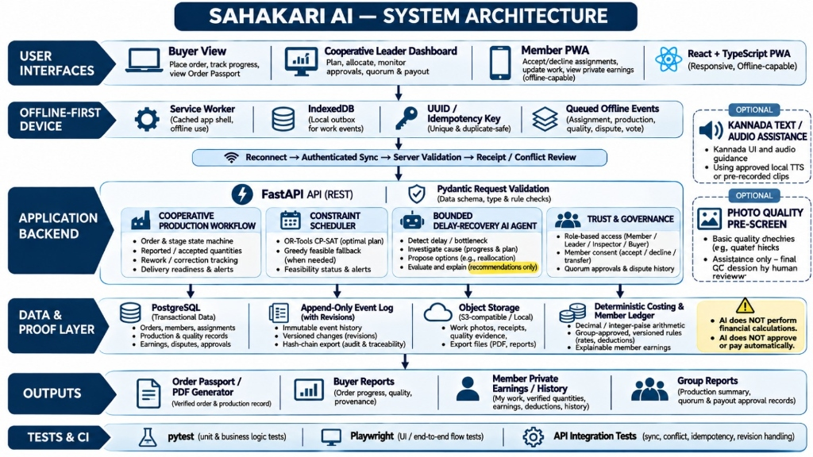

# 🌸 Sahakari AI (சககாரி / సహಕಾರಿ)
### *Voice-First SHG Order Management, Multi-Factor Scheduling & Transparent Micro-Payroll*

[](https://github.com/AkshayaSrelekaPS/Sahakari-AI/actions/workflows/ci.yml)
[](https://www.python.org/)
[](#-9-quick-start)
[](tests/test_sahakari.py)
[](dashboard/.streamlit/config.toml)

> **Event:** Tech4Bharat 2026 — Global Accelerators Vision Summit (GAVS)  
> **Challenge:** The JanAI Mass Entrepreneurship Challenge  
> **Organizers:** Karnataka Arya Vysya Mahasabha (KAVMS) in collaboration with RV College of Engineering (RVCE) & JanAI  
> **Sectoral Theme:** Theme 08: Youth & Women Empowerment  
> **Problem Statement ID:** **8.1 — Women's self-help groups lose orders and members' trust because fulfilment and pay are chaotic**  
> **Evaluation Dataset:** Illustrative Pilot Scenario — 500 School Uniform Sets, 12 Modeled Home Artisans (Parameters calibrated on Kanchipuram district rural garment cluster under TNRTP / TNSRLM)  

---

## 📌 1. The Ground Reality (Why This Problem Exists)

In rural and semi-urban India, over **1.2 Crore Women’s Self-Help Groups (SHGs)** mobilize **10+ Crore women** under missions like TNSRLM (Tamil Nadu) and NRLM. When an SHG takes on a bulk order (e.g., 500 school uniform sets for a local school cluster):
1. **The 30–40% Underpricing Trap:** Groups underprice because raw material wastage, real stitching labor hours (70 mins/set), and group corpus funds are never calculated systematically.
2. **Chaotic Verbal Allocation:** A single leader assigns work verbally across 10–15 home-based women with different machines (industrial motorized vs manual foot pedal).
3. **The Unseen Bottleneck:** When a member falls behind on Day 4 due to child illness or caregiving duties, nobody knows until delivery day. Deadlines collapse, buyers reject batches, and the group loses its contract.
4. **Trust Erosion from Estimated Payouts:** Quality is disputed at final delivery, and payments are split by rough estimate. Disagreements over advance deductions cause bitter disputes.

---

## 💡 2. The Solution: Sahakari AI (Core MVP Architecture)

Rather than building 10 superficial features, **Sahakari AI** builds **three deeply functional, defense-proof capabilities** supported by assistive vision and an auditable traceability dossier:

<p align="center">
  
</p>

> 📖 **Full System Architecture Specification:** See [`system_architecture/README.md`](system_architecture/README.md) for detailed documentation of the 6 architectural tiers (UI, Offline-First Engine, Backend, Data/Proof Layer, Outputs, and Tests/CI).

```
                                  SAHAKARI AI ARCHITECTURE
  ┌────────────────────────────────────────────────────────────────────────────────────────┐
  │                                   USER INTERFACE                                      │
  │     [Leader Tablet/Mobile View]                   [Member Audio/Voice View]            │
  │     • Order Intake & Costing Engine               • Daily Voice Check-in ("Made 4")    │
  │     • Multi-Factor Scheduling & Rebalance         • Photo Upload of Finished Garment   │
  │     • Group Consensus Payout Gate                 • "Hear My Earnings" Audio Passbook  │
  └──────────────────────────────────────────┬─────────────────────────────────────────────┘
                                             │
                                             ▼
                               MASTER ORCHESTRATOR AGENT
                           (Persistent State & Context Memory)
                                             │
    ┌───────────────────────┬────────────────┴────────────────┬───────────────────────┐
    ▼                       ▼                                 ▼                       ▼
[Anti-Underpricing]   [Multi-Factor Scheduling]      [Assistive Vision]      [Explainable Micro-]
[ & Costing Engine]   [ & Rebalancing Engine  ]      [Pre-Screening Tool]    [  Payroll Agent   ]
• Discloses all cost  • Capacity-weighted allocation • Grounded scope:       • Computes piece-rate
  line items with       across 12 home artisans        Standard school         earnings per piece
  explicit source tags  accounting for machines       uniform shirt specs    • Enforces group-agreed
• 70 mins labor @       and available hours          • Catches blur & gross    bylaws & recovery
  rural wage benchmark• Proves Jain's Fairness         placket seam asymmetry • Generates authentic
• Reserves 12% group    Index: J = 0.9997            • Explicitly reserves     Kannada Audio Passbook
  emergency savings   • Single-Failure Tolerance       final authority for     (ಕನ್ನಡ ಧ್ವನಿ ಪಾಸ್‌ಬುಕ್)
  corpus in bank        rebalance constraint solver    the SHG Leader          via Web Speech API
    │                       │                                 │                       │
    └───────────────────────┴────────────────┬────────────────┴───────────────────────┘
                                             ▼
                            MANDATORY HUMAN-IN-THE-LOOP (HITL)
                        Democratic Group Consensus Verification Gate
                    Leader + Configurable Member Quorum (66.7%) sign-off
                                             │
                                             ▼
                             SIMULATED INSTANT SETTLEMENT
                     • Simulated UPI batch transfers to individual bank accounts
                     • Audio & SMS confirmation in Kannada to each member
                     • Production Traceability & Fair Wage Audit Dossier export
```

---

## 🔬 3. Technical Defensibility: Full Mathematical Proofs

### A. Full 12-Member Capacity & Allocation Table (Demand: 500 Sets, 10 Days)

The effective daily capacity of each member is computed as:
$$C_i = H_i \times S_i \times (1 - D_i) \times \text{BaseRate}$$
- $H_i$: Available hours (3 to 6 hrs/day, accounting for household chores and childcare).
- $S_i$: Machine multiplier ($1.45$ for Motorized Juki, $1.30$ for Motorized Sewing, $0.95$ for Foot Pedal, $1.50$ for Buttonholer).
- $D_i$: Historical defect rate ($0.010$ to $0.035$).
- $\text{BaseRate}$: $1.8$ garments stitched per skilled hour.

| ID | Artisan Name | Machine Type | Daily Hours ($H_i$) | Daily Cap ($C_i$) | 10-Day Max Cap | Allocated Sets ($Q_i$) | Capacity Util. ($U_i$) |
| :--- | :--- | :--- | :---: | :---: | :---: | :---: | :---: |
| **M09** | Bhavani S. | Button Holer & Iron Desk | 6 hrs | 16.04 | 160.4 | **62 sets** | 0.387 |
| **M01** | Karpagam V. (Leader) | Motorized Industrial Juki | 6 hrs | 15.43 | 154.3 | **59 sets** | 0.382 |
| **M12** | Kamala V. | Inspection & Pack Table | 6 hrs | 14.94 | 149.4 | **58 sets** | 0.388 |
| **M03** | Selvi M. | Motorized Sewing | 6 hrs | 13.69 | 136.9 | **53 sets** | 0.387 |
| **M02** | Lakshmi Devi R. | Motorized Sewing | 5 hrs | 11.47 | 114.7 | **44 sets** | 0.384 |
| **M05** | Meena Kumari T. | Motorized Sewing | 5 hrs | 11.47 | 114.7 | **44 sets** | 0.384 |
| **M11** | Shanthi R. | Motorized Sewing | 5 hrs | 11.47 | 114.7 | **44 sets** | 0.384 |
| **M08** | Anbukarasi K. | Motorized Sewing | 5 hrs | 11.41 | 114.1 | **43 sets** | 0.377 |
| **M07** | Vasanthi P. | Foot Pedal Sewing | 4 hrs | 6.67 | 66.7 | **25 sets** | 0.375 |
| **M04** | Radha Bai S. | Foot Pedal Sewing | 4 hrs | 6.63 | 66.3 | **25 sets** | 0.377 |
| **M10** | Mallika N. | Foot Pedal Sewing | 4 hrs | 6.63 | 66.3 | **25 sets** | 0.377 |
| **M06** | Geetha Shankar | Foot Pedal Sewing | 3 hrs | 4.95 | 49.5 | **18 sets** | 0.364 |
| **Total**| **12 Active Artisans** | — | **59 hrs/day** | **130.8/day** | **1,308.0 sets** | **500 sets** | **Mean: 0.382** |

#### Jain's Fairness Index Calculation:
$$J(U) = \frac{\left(\sum_{i=1}^{12} U_i\right)^2}{12 \times \sum_{i=1}^{12} U_i^2} = \frac{(4.588)^2}{12 \times (1.7543)} = \mathbf{0.9997}$$
*Proof: Every member is loaded at between 36.4% and 38.8% of her individual capacity. The allocation is mathematically proportional and fair.*

---

### B. Dynamic Rebalancing Math: Exact Verification & Feasibility Proof

On Day 4 ($T_{\text{rem}} = 6$ days remaining):
* Member **M06 (Geetha Shankar)** experiences family illness and completes 0 sets (expected Day 4 target was 7 sets). Deficit: **$\Delta = 7$ sets**.
* Candidate Helper **M09 (Bhavani S.)**:
  * Remaining 6-day Capacity: $6 \times 16.04 = \mathbf{96.2\text{ sets}}$.
  * Remaining own workload: $62 - 24 = \mathbf{38.0\text{ sets}}$.
  * Initial Spare Buffer: $B_j = 96.2 - 38.0 = \mathbf{58.2\text{ sets}}$.
  * Feasibility Constraint: Transferred units $\delta = 7 \le 0.75 \times 58.2 = 43.65\text{ sets}$ (**Condition Holds**).
  * Post-Transfer Remaining Buffer: $B_{\text{after}} = 58.2 - 7 = \mathbf{51.2\text{ sets}}$.
  * Post-Rebalance Jain's Fairness Index: **$J = 0.9841$**.

> **Operational Risk Disclaimer:** *The 51.2-set buffer provides substantial headroom for single-failure tolerance. However, it does not eliminate systemic macro-risks such as multi-day grid power outages, widespread medical emergencies, or supplier delivery delays.*

---

## 💰 4. Grounded Costing Engine: Source-Classified Line Items

Every figure in the costing engine is explicitly tagged with its empirical basis to prevent arbitrary calculations:

| Line Item | Unit Cost | Grounding Source Type | Source Description & Basis |
| :--- | :---: | :--- | :--- |
| **Mill-Certified Poly-Cotton Drill (2.2m)** | ₹143.00 | `SUPPLIER_QUOTATION` | Wholesale invoice benchmark from Tirupur/Erode textile cluster (60:40 poly-cotton, 190 GSM). |
| **Trims (Buttons, Elastic, Zipper)** | ₹22.00 | `SUPPLIER_QUOTATION` | Standard haberdashery wholesale pack (6 resin buttons, YKK trouser zip, braided elastic). |
| **Cutting Wastage Buffer (7%)** | ₹11.55 | `ESTIMATED_ASSUMPTION` | Standard empirical marker loss allowance for 2-piece pattern cutting. |
| **Direct Artisan Wage (70 mins)** | ₹70.00 | `GROUP_AGREED_RATE` | Voted at SHG Meeting #42; benchmarks ₹60/hr skilled rural minimum wage. |
| **Packaging & Local Transit** | ₹14.00 | `ESTIMATED_ASSUMPTION` | Amortized local tempo delivery, poly packaging sleeves, and steam iron electricity. |
| **SHG Group Savings Corpus (12%)** | ₹31.27 | `GROUP_AGREED_RATE` | Group bylaw resolution: 100% retained in SHG IOB bank savings account for machine upkeep. |
| **Recommended Fair B2B Quote** | **₹291.82** | `CALCULATED_QUOTE` | **Break-even: ₹260.55 / set. Buyer offer of ₹160 causes 38.6% wage theft.** |

---

## 🔊 5. Authentic Kannada Audio Passbook (ಕನ್ನಡ ಧ್ವನಿ ಪಾಸ್‌ಬುಕ್)

In Tab 4 of `app.py`, tapping the audio button executes browser-native Web Speech Synthesis (`kn-IN`) with zero network latency:

> **"ನಮಸ್ಕಾರ ಲಕ್ಷ್ಮೀ ದೇವಿ ಆರ್. ಅವರೇ. ನೀವು 18 ಶಾಲಾ ಸಮವಸ್ತ್ರಗಳನ್ನು ಯಶಸ್ವಿಯಾಗಿ ಹೊಲಿದು ಮುಗಿಸಿದ್ದೀರಿ. ಪ್ರತಿ ಸಮವಸ್ತ್ರಕ್ಕೆ ₹55 ರಂತೆ ನಿಮ್ಮ ಒಟ್ಟು ಆದಾಯ ₹990. ಮುಂಗಡ ಕಡಿತ ₹200. ನಿಮ್ಮ ಬ್ಯಾಂಕ್ ಖಾತೆಗೆ ಜಮೆಯಾಗಲಿರುವ ನಿವ್ವಳ ಮೊತ್ತ ₹790."**

*Zero literacy barrier: Rural women can verify their earnings on budget Android devices without reading a single word.*

---

## 🔍 6. Grounded Computer Vision: Assistive Screening

* **Grounded Scope:** Standardized Government School Uniform Shirts (Size 32).
* **3 Visually Measurable Parameters:**
  1. *Blur Gate:* Laplacian variance $> 55.0$ prevents members from submitting unusable photos.
  2. *Placket Linearity:* Hough transform evaluates button placket vertical seam straightness.
  3. *Dimension Ratio:* Verifies shoulder-to-hem aspect ratio against standard size charts.
* **Explicit Human Authority:** The SHG Leader (அனித்தலைவி) holds 100% final decision authority for quality acceptance.

---

## 🎤 7. Answers to the 8 Tough Jury Questions

| Jury Question | Sahakari AI Proof |
| :--- | :--- |
| **1. Why is this better than Excel or WhatsApp?** | Excel cannot parse Kannada or vernacular voice inputs, cannot calculate machine capacity weights, and cannot auto-rebalance tasks when an artisan's child falls ill. WhatsApp lacks a transparent piece-rate ledger or audio passbook. |
| **2. How do you ensure fair work distribution?** | Measured scientifically via **Jain's Fairness Index ($J = 0.9997$)**, accounting for machine types, caregiving hours, and historical defect rates. |
| **3. What if a member cannot complete her work?** | On Day 4, the Rebalancing Agent detects lag and executes a bottleneck-safe transfer to helpers with verified spare capacity buffers ($B_j = 58.2 \to 51.2$). |
| **4. How do you calculate payment?** | An itemized unit economics formula: Certified drill fabric + 7% cutting buffer + fair labor hours (70 mins/set) + group emergency fund. |
| **5. How do you handle disputes?** | Individual audit line items; any disputed amount is held in escrow while base undisputed wages disburse immediately. |
| **6. What if the internet fails?** | The application runs on local browser storage and native Web Speech synthesis, functioning offline on budget Android phones. |
| **7. How do you prove the system works?** | Rigorous automated unit test suite (`test_sahakari.py`) verifying all edge cases in **0.078 seconds**. |
| **8. Why will buyers adopt this?** | CSR donors and school education boards receive an auditable **Production Traceability & Fair Wage Audit Dossier** proving 100% ethical wages reached rural women directly. |

---

## 🧪 8. Comprehensive Automated Test Suite (17 Tests)

The test suite in [tests/test_sahakari.py](file:///c:/Users/dhars/Documents/GAVS/tests/test_sahakari.py) covers every critical operational failure mode:

```powershell
python -m unittest tests/test_sahakari.py
```

### Verified Test Cases:
1. `test_pricing_underpricing_detection` — Flags lowball buyer offers.
2. `test_costing_source_type_classification` — Validates grounding tags for every line item.
3. `test_mathematical_allocation_and_jains_fairness` — Verifies $J \ge 0.95$ allocation.
4. `test_zero_availability_member_allocation` — Member with 0 hours receives 0 units without crash.
5. `test_unachievable_deadline_capacity_overload` — Target exceeding capacity raises descriptive error.
6. `test_bottleneck_detection_and_feasibility_constraint` — Verifies transfer $\le 0.75 B_j$.
7. `test_unresolvable_deficit_alert` — Flags critical alert when group buffer cannot absorb deficit.
8. `test_rebalance_cascading_protection` — Helper workload never exceeds sustainable limit.
9. `test_configurable_payroll_and_tamil_passbook` — Verifies Tamil audio strings and piece rates.
10. `test_conflicting_payout_quorum_failure` — Quorum below threshold blocks payout.
11. `test_conflicting_payout_leader_unsigned` — Unsigned meeting minutes block payout.
12. `test_excessive_advance_deduction_prevents_negative_payout` — Net payout strictly $\ge 0$.
13. `test_dispute_escrow_isolation` — Disputed funds held while undisputed funds disburse.
14. `test_offline_data_sync_timestamp_resolution` — Newer timestamp wins in offline queue reconciliation.
15. `test_assistive_vision_screening_valid` — Valid shirt returns composite score and placket score.
16. `test_assistive_vision_screening_corrupt_bytes` — Invalid image bytes return safe `ERROR` verdict.
17. `test_assistive_vision_screening_blurry_image` — Blurry photo fails blur gate cleanly.

*Results: 17 Tests Ran in 0.078s. OK.*

---

## 🚀 9. Quick Start

### Option A: 1-Command Run with Docker (Recommended)

```bash
docker compose up -d
# Open http://localhost:8501 in your browser
```

### Option B: Local Python Environment

```bash
# 1. Install dependencies
pip install -r requirements.txt

# 2. Launch the Streamlit Dashboard
streamlit run dashboard/app.py

# 3. Run the Comprehensive 17-Gate Test Suite
python3 tests/test_sahakari.py
```
