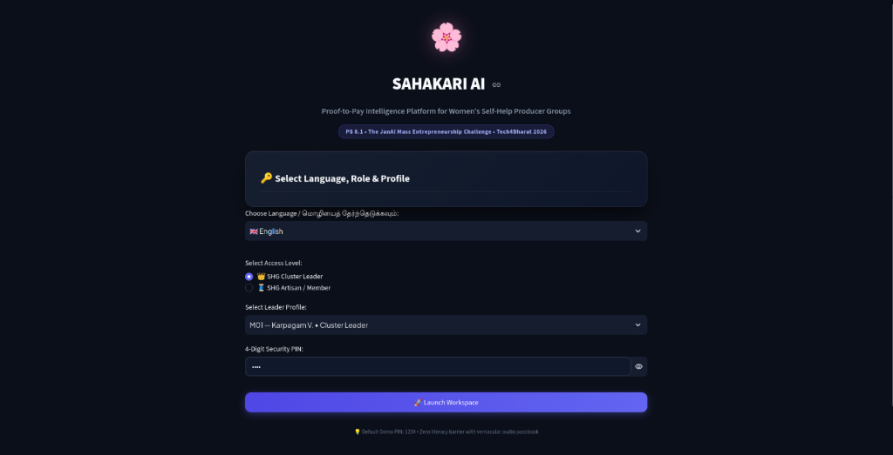
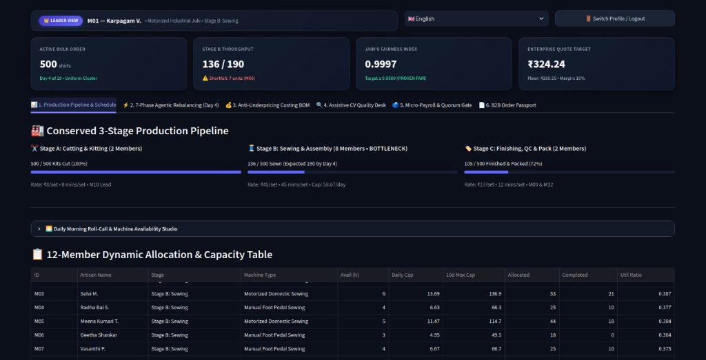
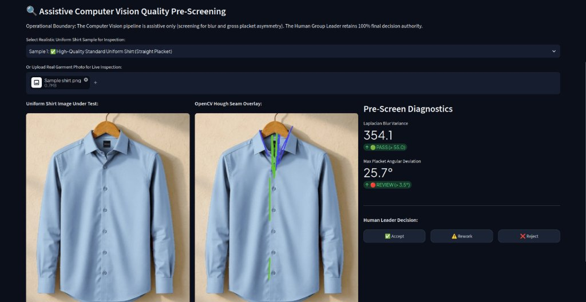
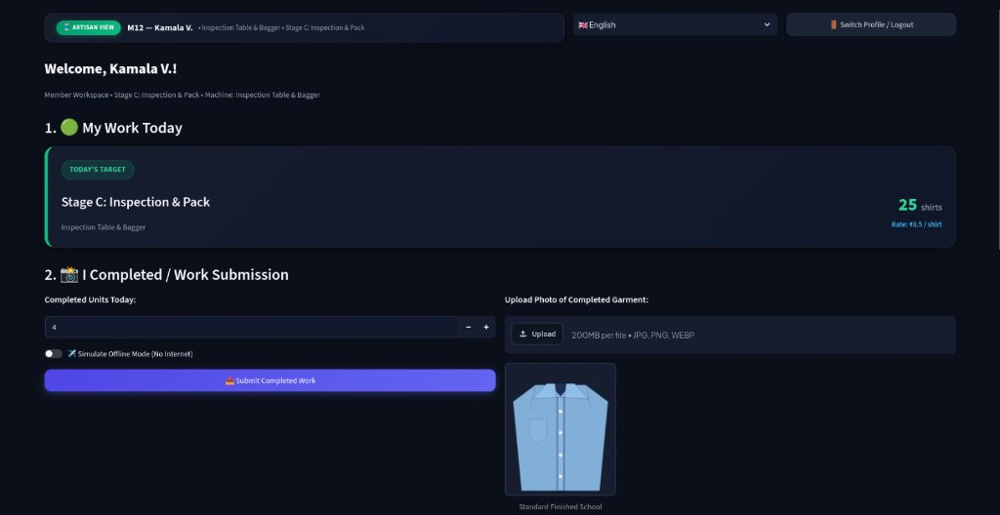
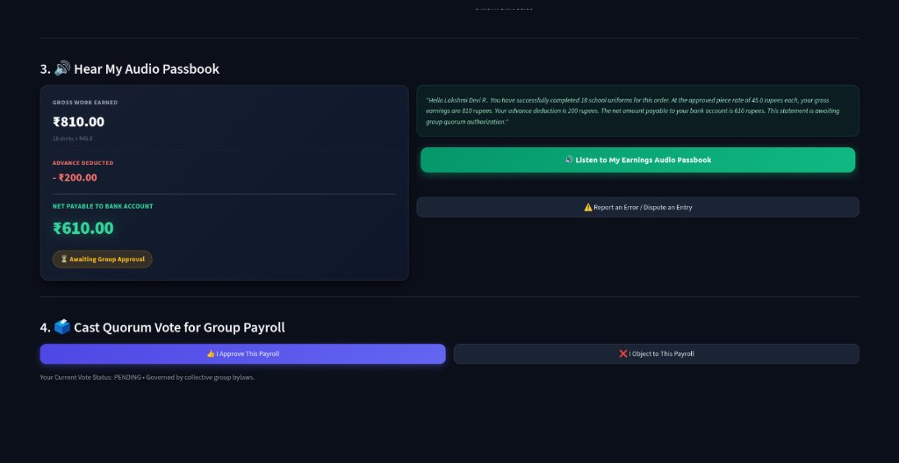

# 🌸 Sahakari AI — Dashboard Visual Tour & Interface Gallery

This gallery documents the core user interfaces of **Sahakari AI**, demonstrating the platform's dual-role workflows, mathematical workload fairness, assistive computer vision inspection, and vernacular low-literacy voice passbooks.

---

## 1. Gateway Authentication & Multilingual Access

  

> **Caption:** **Multilingual Gateway Authentication & Dual-Role Access**  
> **Key Capabilities:**
> - **Zero-Barrier Multilingual Selection:** Supports native English, Tamil (`தமிழ்`), Kannada (`ಕನ್ನಡ`), and Hindi (`हिन्दी`).
> - **Dual-Role Separation:** Distinct role selection between **Cluster Leader Command Desk** (secured by a 4-digit PIN) and **SHG Artisan / Member View**.
> - **Lightweight Gateway:** Clean dark-mode interface designed to load instantly over 2G/3G rural networks.

---

## 2. Leader Command Desk: 3-Stage Pipeline & Workload Fairness

  

> **Caption:** **Conserved 3-Stage Pipeline & Capacity-Weighted Allocation**  
> **Key Capabilities:**
> - **Conserved Manufacturing Pipeline:** Real-time visibility into **Stage A (Cutting & Kitting)**, **Stage B (Sewing & Assembly — Bottleneck)**, and **Stage C (Finishing, QC & Packing)**.
> - **Morning Roll-Call & Machine Calibration:** Allows leaders to adjust daily artisan working hours and machine health every morning.
> - **12-Member Dynamic Allocation Table:** Quota allocation mathematically weighted by machine speed multipliers (Juki 1.45x, foot-pedal 0.95x) and defect rates.
> - **Mathematical Fairness Proof:** Proves **Jain's Fairness Index ($J = 0.9997 \ge 0.9500$)**, guaranteeing equitable workload distribution without overworking any artisan.

---

## 3. Assistive Computer Vision Quality Pre-Screening Desk

  

> **Caption:** **Assistive Computer Vision Quality Pre-Screening Desk**  
> **Key Capabilities:**
> - **Real Garment Pre-Screening:** Evaluates standard uniform shirts against visual quality benchmarks using OpenCV.
> - **Laplacian Blur Variance:** Instant focus check ($354.1 > 55.0$ PASS) to eliminate blurry, uninspectable photo evidence.
> - **Hough Seam Linearity Overlay:** Traces the front placket seam and computes maximum angular deviation ($25.7^\circ$).
> - **Human-in-the-Loop Authority:** The AI serves purely as an assistive pre-screener; **100% final approval, rework, or rejection authority is reserved for the human cluster leader.**

---

## 4. Artisan Member Workspace: Today's Target & Work Submission

  

> **Caption:** **Artisan Member View — Daily Target Card & Offline Work Submission**  
> **Key Capabilities:**
> - **Low-Literacy Daily Target:** Prominently displays the artisan's daily target (e.g., 25 shirts for Stage C Inspection & Pack @ ₹8.5/shirt).
> - **1-Tap Work Submission:** Simple increment/decrement counter for completed pieces with photo evidence upload.
> - **Offline Queuing Support:** Includes a "Simulate Offline Mode" toggle demonstrating IndexedDB outbox queueing with UUID v4 idempotency keys for unreliable rural connectivity.

---

## 5. Vernacular Audio Passbook & Democratic Quorum Voting

  

> **Caption:** **Vernacular Audio Passbook & 66% Quorum Wage Authorization**  
> **Key Capabilities:**
> - **Transparent Financial Breakdown:** Displays gross earnings (₹810.00), advance deductions (-₹200.00), and net payable (₹610.00) calculated using integer-paise deterministic arithmetic.
> - **Native Speech Synthesis:** Tapping *"Listen to My Earnings Audio Passbook"* triggers browser-native Web Speech synthesis (`kn-IN` / `ta-IN` / `hi-IN`) speaking the full financial summary without reading required.
> - **Democratic Quorum Gate:** Every artisan casts her own cryptographic vote (`Approve` or `Object`) directly on her phone; payouts require a **66% member quorum** to prevent arbitrary wage deductions.
