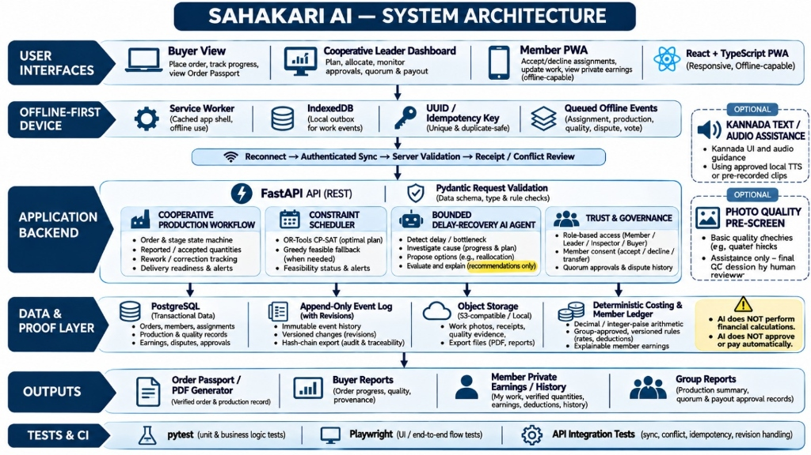

# Sahakari AI — System Architecture

Comprehensive architectural overview and end-to-end component blueprint for the **Sahakari AI** cooperative production and proof-to-pay platform.

---

## 📐 Architecture Diagram

---

## 🏛️ Layered Architectural Breakdown

### 1. User Interfaces (UI Tier)
- **Buyer View:** Order placement portal, milestone tracker, and verified digital **Order Passport** inspector.
- **Cooperative Leader Dashboard:** Executive command desk for daily morning roll-call, constraint-based quota allocation, delay investigation, quality review, and payout quorum initiation.
- **Member PWA (Progressive Web App):** Minimalist, low-literacy mobile client for artisans to view daily quotas, log completed pieces, submit photo evidence, listen to vernacular audio passbooks, and vote in wage quorums.
- **Tech Stack:** React + TypeScript PWA, fully responsive and PWA Service-Worker enabled for offline operation in low-connectivity rural hubs.

---

### 2. Offline-First Device Engine
- **Service Worker:** Caches application shell, static assets, and core state machines for uninterrupted offline access.
- **IndexedDB (Local Outbox):** Stores pending work events, photo attestations, piece counts, and quorum votes when connectivity drops.
- **UUID & Idempotency Keys:** Every client transaction receives a client-side UUID $v4$ idempotency key, preventing accidental double-submissions or duplicate records upon reconnect.
- **Queued Offline Events:** Batches assignments, production records, quality checks, dispute logs, and votes.
- **Sync Pipeline:**  
  $$\text{Reconnect} \longrightarrow \text{Authenticated Sync} \longrightarrow \text{Server Validation} \longrightarrow \text{Receipt / Conflict Review}$$
- **Vernacular Audio Assistance:** Integrated text-to-speech and audio feedback in local languages (**Kannada, Tamil, Hindi**) providing voice assistance for artisans.

---

### 3. Application Backend (FastAPI & AI Orchestrator)
- **FastAPI REST API:** High-throughput asynchronous REST gateway with OpenAPI documentation.
- **Pydantic Request Validation:** Strict type enforcement, rule validators, and data schema sanitization on all endpoints.
- **Cooperative Production Workflow:** State machine managing multi-stage manufacturing (Cutting $\rightarrow$ Sewing assembly $\rightarrow$ Finishing), tracking reported vs. accepted quantities, rework loops, and delivery readiness alerts.
- **Constraint Scheduler (OR-Tools CP-SAT):** Mathematical constraint programming optimizer balancing artisan machine health, skill matrix, and daily hours, backed by a greedy heuristic fallback for offline/instant solve.
- **Bounded Delay-Recovery AI Agent:**
  - Continuously monitors production buffers and flags shortfalls.
  - Investigates bottlenecks and proposes spare-buffer transfers.
  - **Human-in-the-Loop Guardrail:** The agent generates *recommendations only*; all transfers require voluntary member consent before execution.
- **Trust & Governance:** Role-Based Access Control (RBAC) across Leaders, Artisans, Quality Inspectors, and Institutional Buyers, with democratic 66% quorum consensus requirements for micro-payroll payouts.
- **Assistive Photo Quality Pre-Screen:** Computer vision desk using OpenCV Laplacian blur variance and Hough placket linearity checks to flag defects while reserving all approval decisions for the human leader.

---

### 4. Data & Proof Layer
- **PostgreSQL:** Primary transactional database for relational models, member profiles, machine inventories, orders, and quality logs.
- **Append-Only Event Log (with Revisions):** Immutable, audit-grade event stream recording every allocation change, transfer proposal, and approval with cryptographic hash chains.
- **Object Storage (S3 / Local):** Secure store for garment inspection photos, digital receipts, audio clips, and generated PDF passports.
- **Deterministic Costing & Member Ledger:**
  - Strictly integer-paise / decimal fixed-point arithmetic (zero floating-point rounding errors).
  - Versioned bylaws for transparent piece rates, machine depreciation reserves, and advance recovery.
- **⚠️ Hard System Guardrails:**
  - AI does **NOT** perform financial arithmetic.
  - AI does **NOT** auto-approve or disburse payments.

---

### 5. Outputs & Traceability Dossier
- **Order Passport / PDF Generator:** Tamper-evident batch certification document for B2B buyers proving living wage compliance, fair labor distribution ($J \ge 0.95$), and quality verification.
- **Buyer Reports:** Order progress dashboards, itemized material provenance, and quality pass rates.
- **Member Private Earnings / History:** Explainable breakdown of gross earnings, deductions, net payable, and personal ledger history.
- **Group Reports:** Aggregated cooperative production summaries, audit stamps, and quorum voting logs.

---

### 6. Tests & Continuous Integration (CI)
- **pytest:** 100% test passage across unit, mathematical fairness (Jain's index), and business logic test suites (`tests/test_sahakari.py`).
- **Playwright:** Headless automated browser test suite driving end-to-end role workflows and interface validation.
- **API Integration Tests:** Automated testing for sync reconciliation, idempotency deduplication, conflict resolution, and hash-chain audit integrity.

